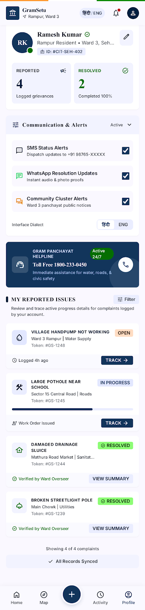
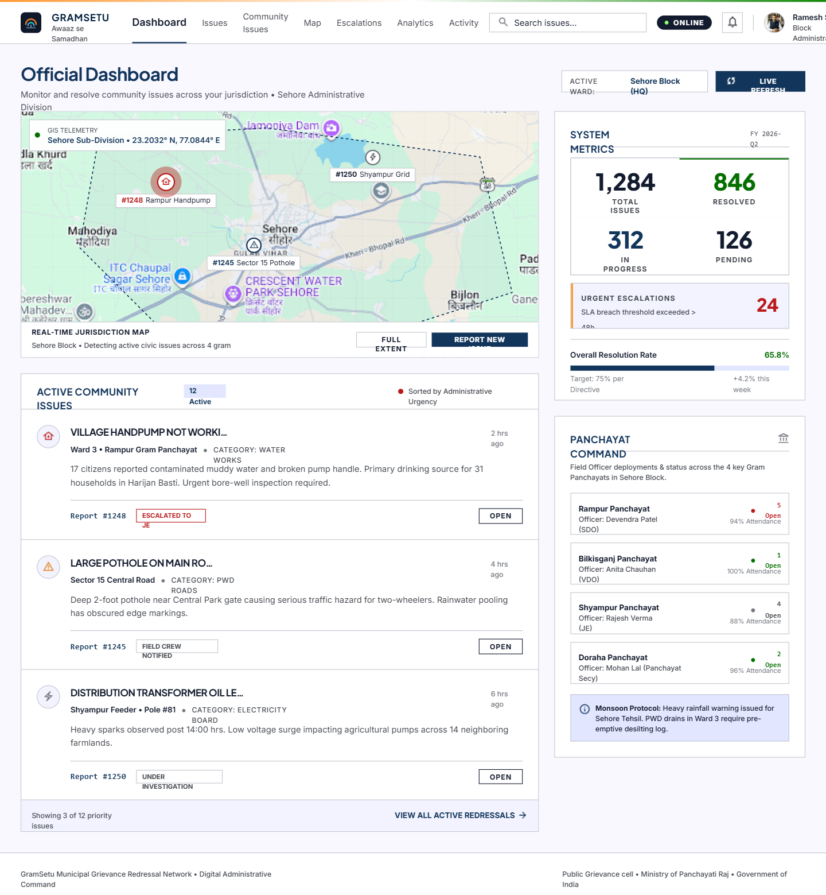
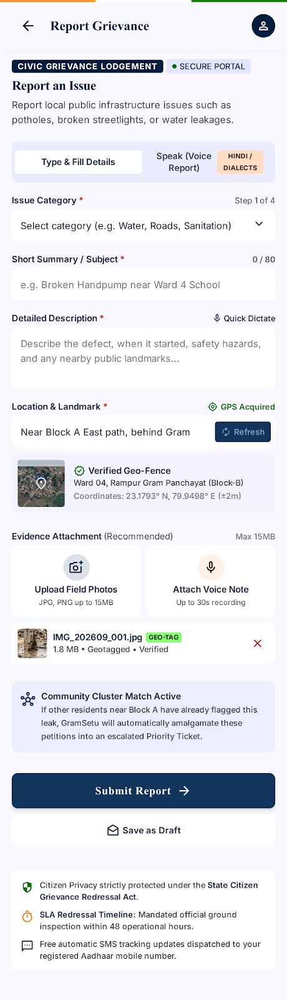
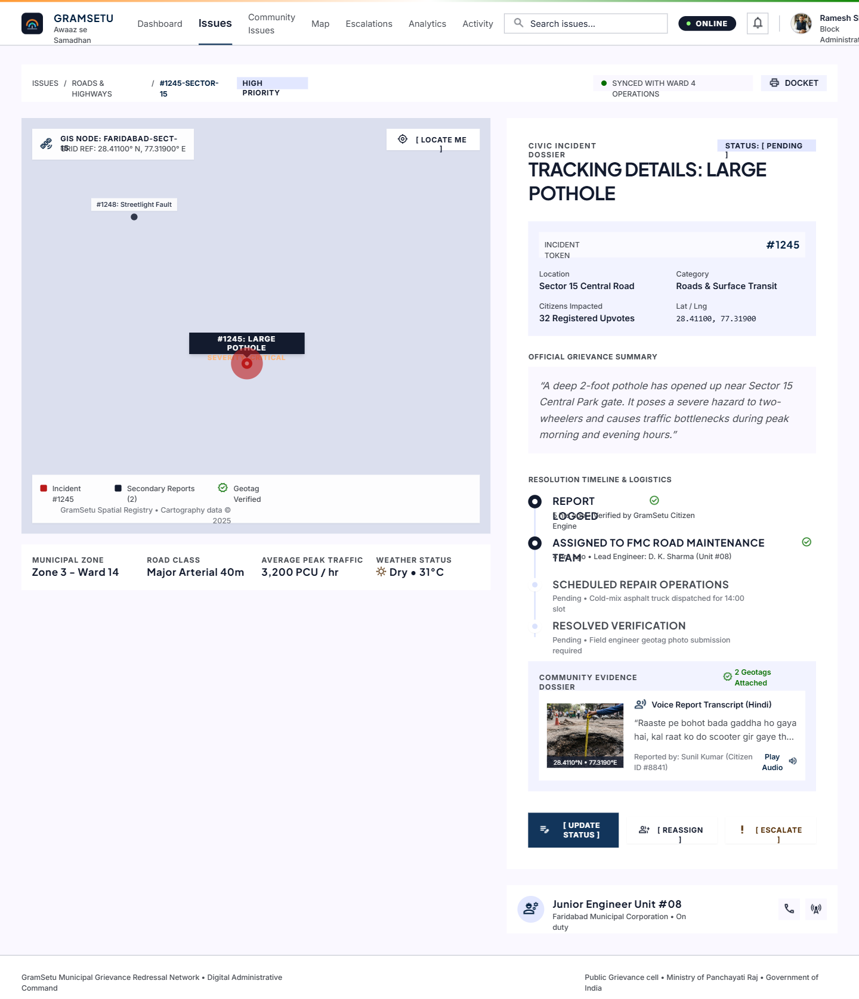

# GramSetu (आवाज़ से समाधान)

> **Voice-First Civic Grievance Redressal and Spatial Duplicate Detection System for Rural Gram Panchayats**

[](https://react.dev/)
[](https://www.typescriptlang.org/)
[](https://vitejs.dev/)
[](https://tailwindcss.com/)
[](https://leafletjs.com/)
[](LICENSE)

---

## 📌 Executive Summary

GramSetu is an edge-optimized civic redressal platform engineered for rural Gram Panchayats. Conventional grievance portals demand text literacy and formal Hindi/English phrasing, isolating rural villagers who communicate predominantly via spoken regional dialects (Bundeli, Malwi, colloquial rural Hindi). Furthermore, when key rural infrastructure (such as a drinking water handpump or transformer) malfunctions, dozens of localized complaints overwhelm the administration with duplicate backlog.

GramSetu solves these core challenges through:
1. **Voice-First Grievance Lodging**: In-browser speech capture utilizing the Web Speech API and live audio spectral visualizers (`Web Audio API` `AnalyserNode`).
2. **Hybrid Semantic & Geospatial Duplicate Detection**: An ontology-boosted keyword extractor combined with the Haversine spherical distance metric to identify nearby duplicate complaints, clustering them into unified civic petitions with endorsement metrics.
3. **Panchayat Command & GIS Telemetry**: Full administrative interface with multi-tier SLA escalation tracking (Gram Panchayat → Block → Zilla Parishad → District Oversight), interactive OpenStreetMap/ESRI satellite layers, and DPDP Act 2023 compliant audit logs.

---

## 📸 System Previews

| Citizen Interface | Panchayat Command Dashboard |
| :---: | :---: |
|  |  |
| *Voice-first grievance launchpad & dialect support* | *Real-time GIS telemetry and community issue backlog* |

| GIS Telemetry & Map Grid | Official Incident Dossier |
| :---: | :---: |
|  |  |
| *Ward-level clustering & GPS geotagging* | *Community evidence, audio playback & SLA escalation* |

---

## 🚀 Key Architectural Capabilities

### 1. Multimodal Speech Processing
- **Live Spectral Analysis**: Uses `AudioContext` and `AnalyserNode` with Fast Fourier Transform (FFT) bins to visualize microphone input dynamics in real time.
- **Dialect & Vernacular Support**: Pre-calibrated speech recognition pipelines accepting Hindi, English, and rural phonetic variations.
- **Microphone Hardware Integration**: Interfaces directly with `navigator.mediaDevices.getUserMedia` for authentic browser-level voice capture and playback.

### 2. Semantic NLP & Spatial Deduplication Engine
- **Vernacular Keyword Matching**: Lexical ontology covering 10 rural civic domains:
  1. Water Supply & Handpumps (जल / हैंडपंप / बोरवेल)
  2. Roads, Potholes & Transit (सड़कें / गड्ढे / पुलिया)
  3. Electricity, Transformers & Grid (बिजली / ट्रांसफार्मर)
  4. Sanitation, Drainage & Garbage (नाली / जलभराव / कचरा)
  5. Public Health & Dispensaries (स्वास्थ्य / अस्पताल / डिस्पेंसरी)
  6. Street Lighting & Night Safety (स्ट्रीट लाइट / खंभे की लाइट)
  7. Irrigation & Minor Canals (सिंचाई / नहर / खेत)
  8. Schools & Anganwadi Centers (स्कूल / आंगनवाड़ी)
  9. Ration, PDS & Social Welfare (राशन / कोटेदार / पेंशन)
  10. Stray Cattle & Animal Welfare (आवारा पशु / मवेशी / गोशाला)
- **Spatial Proximity Radius**: Computes distance via the Haversine formula:
  $$d = 2R \arcsin\left(\sqrt{\sin^2\left(\frac{\Delta\phi}{2}\right) + \cos(\phi_1)\cos(\phi_2)\sin^2\left(\frac{\Delta\lambda}{2}\right)}\right)$$
- **Consolidation**: Incidents logged within 500 meters sharing semantic characteristics are clustered, converting secondary complaints into upvotes/endorsements on the primary work order.

### 3. Administrative Governance & 4-Tier SLA Escalation
- **State Machine Hierarchy**:
  - **Tier 1 (Gram Panchayat)**: Gram Sachiv (VDO) & Pradhan (Initial 48 hours).
  - **Tier 2 (Block Level)**: Block Development Officer (BDO) & Junior Engineer (48–96 hours).
  - **Tier 3 (Zilla Parishad)**: Chief Executive Officer (CEO Zilla Parishad) (96–144 hours).
  - **Tier 4 (District Oversight)**: District Magistrate / Collector (> 144 hours breach threshold).
- **Audit Ledger**: Comprehensive activity log detailing token IDs, timestamped actions, officer dispatches, and citizen photo verification.

---

## 📂 Project Structure

```
gramsarthi/
├── docs/
│   └── screenshots/              # System UI preview captures
├── public/
│   └── audio/                    # Benchmark speech audio references
├── src/
│   ├── components/
│   │   ├── auth/
│   │   │   └── CommonLogin.tsx            # Unified Citizen / Official role authentication
│   │   ├── citizen/
│   │   │   ├── CitizenHome.tsx            # Citizen dashboard & quick voice launchpad
│   │   │   ├── CitizenReportIssue.tsx     # Voice recording, GPS pin picker & duplicate alert
│   │   │   ├── CitizenMap.tsx             # Interactive GIS ward map with community markers
│   │   │   ├── CitizenIssueTracking.tsx   # 6-step resolution timeline with photo verification
│   │   │   └── CitizenProfile.tsx         # Citizen credentials, token records & activity
│   │   └── official/
│   │       ├── OfficialDashboard.tsx      # Command center with GIS telemetry & metric counters
│   │       ├── OfficialMap.tsx            # Jurisdictional GIS telemetry grid
│   │       ├── OfficialIssueDetail.tsx    # Incident dossier, audio playback & status updates
│   │       ├── OfficialActivity.tsx       # Live audit stream & immutable event log
│   │       ├── OfficialCommunityIssues.tsx# Cluster manager & duplicate similarity viewer
│   │       ├── OfficialEscalations.tsx    # 4-Tier administrative SLA escalation matrix
│   │       └── OfficialProfile.tsx        # Official credential dossier & assigned wards
│   ├── context/
│   │   └── AppContext.tsx                 # Central reactive state store with localStorage sync
│   ├── data/
│   │   ├── humanVoiceClips.ts             # Audio asset mappings
│   │   └── mockData.ts                    # Curated district geospatial telemetry dataset
│   ├── types/
│   │   └── index.ts                       # Domain contracts, schemas & TypeScript types
│   ├── utils/
│   │   ├── audioPlayback.ts               # Web Audio API audio stream helpers
│   │   ├── locationResolver.ts            # Geolocation & reverse geocoding utilities
│   │   ├── similarityEngine.ts            # NLP keyword indexer & Haversine proximity matcher
│   │   └── translations.ts                # Bilingual English / Hindi localization dictionaries
│   ├── App.tsx                            # Root application view router
│   ├── main.tsx                           # React entry point
│   └── index.css                          # Tailwind CSS styling and theme primitives
├── index.html
├── package.json
├── tsconfig.json
└── vite.config.ts
```

---

## 🛠️ Technology Stack

| Domain | Technologies |
|---|---|
| **Frontend Framework** | React 19, TypeScript |
| **Build & Tooling** | Vite 8, Rolldown engine |
| **Styling & Design** | Tailwind CSS v4, Lucide Icons |
| **Geospatial & Mapping** | Leaflet, React-Leaflet, OpenStreetMap, ESRI Satellite Tiles |
| **Speech & Audio** | Web Speech API (`webkitSpeechRecognition`), Web Audio API (`AudioContext`, `AnalyserNode`), `MediaRecorder` |
| **State & Persistence** | React Context API, Browser LocalStorage, Indexed Corpus |

---

## ⚙️ Getting Started

### Prerequisites
- Node.js (v18.x or higher)
- npm (v9.x or higher)

### Installation & Run

1. **Clone the repository**:
   ```bash
   git clone https://github.com/jiya25bai10733-gif/GramSetu.git
   cd GramSetu
   ```

2. **Install dependencies**:
   ```bash
   npm install
   ```

3. **Launch the development server**:
   ```bash
   npm run dev
   ```
   Open [http://localhost:5173](http://localhost:5173) in your browser.

4. **Build for production**:
   ```bash
   npm run build
   ```
   Verify that all TypeScript types compile without errors.

---

## 👥 Contributors

- **Divyanshi Upadhyay** (25BAI10585)
- **Aanya Yadav** (25BAI10190)
- **Jiya Kalra** (25BAI10733)
- **Uchit Jain** (25BAI10798)
- **Daniel David** (25BAI11146)

**Under the guidance of**:  
*Dr. Pradeep Kumar Mishra*  
*School of Computing Science and Engineering, VIT Bhopal University*

---

## 📄 License

This project is licensed under the MIT License — see the [LICENSE](LICENSE) file for details.
